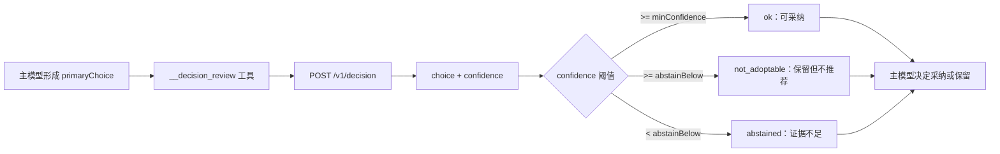

<div align="center">
  <h1>dsh-decision-review</h1>
  <p><strong>主模型继续拍板，第二个模型只提供复核意见。</strong></p>
  <p>把“独立复核”做成 DeepSeek Harness 里的一个工具，而不是替模型做决定。</p>

  <p>
    
    
    
    <a href="LICENSE"></a>
  </p>

  <p>简体中文 · <a href="README_EN.md">English</a></p>
</div>

> [!NOTE]
> 这是一个 DSH bundle，安装后默认 `mode: off`，不会产生任何调用。要真正启用，需要一个兼容 `POST /v1/decision` 的复核服务，并显式配置 `model` 与 `baseUrl`。

## 为什么做这个插件

让同一个模型先产出结论再自我复核，往往只是重复一遍它的理由。独立复核的价值在于“第二意见”：复核方只看到问题、主模型的预选、证据与约束，不参与原始推理，也不掌握工具权限。

主模型必须先形成 `primaryChoice`，插件才发起复核。复核返回的建议会连同置信度一起回到主模型手里，采纳、保留还是询问用户，仍由主模型决定。



## 核心能力

| 能力 | 使用体验 |
| --- | --- |
| 三种模式 | `off` 不注册；`shadow` 只记录不回灌；`advisory` 返回结构化建议 |
| 不替模型决策 | 复核只给建议与置信度，最终选择仍在主模型 |
| 结构化产出 | 固定返回 `status`、`recommendation.choice`、`confidence`、`reasonCode` |
| 置信度分层 | 达标可采纳、未达标保留、过低视为弃权 |
| 失败不重试 | 复核失败立即返回原因，主模型按原判断继续 |
| 日志脱敏 | 只记录点位、状态、原因码、模型、HTTP 状态、请求 id、输入指纹与耗时 |
| 权限隔离 | 权限、审批、写操作、网络目标、工具白名单永不交给复核方 |

## 复核协议

复核端点是结构化决策接口，不是 OpenAI 兼容的聊天接口：

```text
POST {baseUrl}/v1/decision
Authorization: Bearer {DECISION_API_KEY}
```

请求体只有三个顶层字段：`{ model, state, questions }`。

| 字段 | 来源 |
| --- | --- |
| `state.question` | 工具入参 `question` |
| `state.primaryChoice` | 工具入参 `primaryChoice` |
| `state.evidence` | 工具入参 `evidence` |
| `state.constraints` | 工具入参 `constraints` |
| `questions.recommendation.criteria` | 工具入参 `options` |
| 返回值 | `answers.recommendation.choice` 与 `confidence` |

`probabilities` 只透传给主模型参考，不参与判定。`baseUrl` 是网关根地址，插件自己拼接路径；已经以 `/v1` 或端点路径结尾的地址会在启动时被拒绝。

## 安装

```sh
dsh plugin --profile <name> add dsh-decision-review
dsh plugin --profile <name> add /path/to/dsh-decision-review
dsh plugin --profile <name> add github:ninetyhe-90/dsh-decision-review
```

## 配置

| 字段 | 类型 | 默认 | 说明 |
| --- | --- | --- | --- |
| `mode` | `off` \| `shadow` \| `advisory` | `off` | 运行模式 |
| `model` | `string` | 无 | 必填，复核模型名，插件不提供默认值 |
| `baseUrl` | `string` | 空 | 复核服务根地址，不含 `/v1` |
| `apiKeyEnv` | `string` | `DECISION_API_KEY` | 存放凭据的环境变量名 |
| `allowedDecisionPoints` | `string[]` | `[]` | 允许调用复核的决策点名，任意合法命名均可 |
| `timeoutMs` | `number` | `5000` | 单次复核超时 |
| `minConfidence` | `number` | `0.75` | 可采纳阈值 |
| `abstainBelow` | `number` | `0.5` | 弃权阈值，不得高于 `minConfidence` |
| `promptSection` | `boolean` | `true` | 是否注入提示段 |
| `promptSectionOrder` | `number` | `30` | 提示段顺序 |
| `systemExtra` | `string` | 空 | 追加到复核请求的领域约束 |

```yaml
- insert:
    - id: decision-review
      name: dsh-decision-review
      config:
        mode: advisory
        model: your-decision-model
        baseUrl: https://your-gateway
        allowedDecisionPoints:
          - custom_review_point
```

## 失败码

| `reasonCode` | 含义 |
| --- | --- |
| `timeout` / `cancelled` | 本地超时，或父请求被取消 |
| `upstream_timeout` | 网关报告上游超时（HTTP 504） |
| `credential_unavailable` | 凭据环境变量缺失 |
| `authentication_failed` | 凭据缺失或被拒绝（HTTP 401） |
| `model_not_authorized` | 凭据无权使用该模型（HTTP 403） |
| `model_unsupported` | 网关不认识该模型名 |
| `invalid_request` | 请求体被拒绝（HTTP 400） |
| `route_unavailable` | HTTP 404，检查 `baseUrl` 是否为网关根地址 |
| `rate_limited` / `quota_exceeded` | 上游限流或额度耗尽 |
| `context_too_large` | HTTP 413 |
| `invalid_response` / `response_too_large` | 响应无法解析或超出上限 |
| `provider_error` | 其它网络或服务端错误 |

## 安全边界

- 复核方不获得任何工具、文件、网络或审批权限。
- 权限提升、用户确认、写操作、网络目标与工具白名单不进入复核范围。
- 复核结果只是建议，不能绕过主模型的判断与宿主的确认流程。
- 日志不记录请求正文与原始错误，只记录结构化元数据。

## 兼容性

- Node.js 20.11+
- DeepSeek Harness 0.2.x：需要 `ctx.tools`、`ctx.logger`；缺少 `ctx.systemPrompt` 时跳过提示段注入
- `@deepseek-ai/schemastery` 3.18.x

## 项目结构

```text
src/decision-core.mjs    配置校验、输入归一化、提示段与失败码
src/decision-model.mjs   工具注册、复核请求与结果映射
test/                    配置、协议与工具行为测试
cordis.patch.yml         bundle 层，默认 mode: off
```

## 开发与验证

```sh
npm install --include=dev
npm test
npm run check
```

## 路线图

- [x] 三档模式与置信度分层
- [x] 结构化失败码与日志脱敏
- [x] 可配置决策点白名单
- [x] bundle 安装形式
- [ ] npm 发布
- [ ] 复核服务的最小参考实现

## 许可证

MIT
