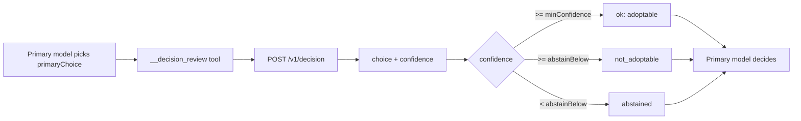

<div align="center">
  <h1>dsh-decision-review</h1>
  <p><strong>The primary model keeps deciding; a second model only advises.</strong></p>
  <p>Independent review as a DeepSeek Harness tool, not a replacement for the decision maker.</p>

  <p>
    
    
    
    <a href="LICENSE"></a>
  </p>

  <p><a href="README.md">简体中文</a> · English</p>
</div>

> [!NOTE]
> This bundle installs with `mode: off` and makes no calls. Enabling it requires a compatible
> `POST /v1/decision` service plus an explicit `model` and `baseUrl`.

## Why this plugin

Asking one model to check its own answer usually repeats its own reasoning. A second opinion is
useful only when the reviewer sees the question, the primary choice, the evidence, and the
constraints without joining the original reasoning or holding tool permissions.

The primary model must commit to `primaryChoice` before review starts. The suggestion and its
confidence return to the primary model, which still decides whether to adopt, keep, or ask the user.



## Capabilities

| Capability | Behaviour |
| --- | --- |
| Three modes | `off` registers nothing; `shadow` logs only; `advisory` returns a suggestion |
| No decision hijack | Review returns advice and confidence; the primary model still chooses |
| Structured output | `status`, `recommendation.choice`, `confidence`, `reasonCode` |
| Confidence tiers | Adoptable, keep-but-not-recommended, or abstained |
| No retries | A failed review returns immediately; the primary judgement stands |
| Redacted logs | Point, status, reason code, model, HTTP status, request id, input fingerprint, latency |
| Permission isolation | Permissions, approvals, writes, network targets, and allowlists never reach the reviewer |

## Protocol

```text
POST {baseUrl}/v1/decision
Authorization: Bearer {DECISION_API_KEY}
```

The body has exactly three top-level fields: `{ model, state, questions }`.

| Field | Source |
| --- | --- |
| `state.question` | Tool input `question` |
| `state.primaryChoice` | Tool input `primaryChoice` |
| `state.evidence` | Tool input `evidence` |
| `state.constraints` | Tool input `constraints` |
| `questions.recommendation.criteria` | Tool input `options` |
| Response | `answers.recommendation.choice` and `confidence` |

`probabilities` are informational only. `baseUrl` is the gateway root; an address already ending in
`/v1` or the endpoint path is rejected at startup.

## Install

```sh
dsh plugin --profile <name> add dsh-decision-review
dsh plugin --profile <name> add /path/to/dsh-decision-review
dsh plugin --profile <name> add github:ninetyhe-90/dsh-decision-review
```

## Configuration

| Field | Type | Default | Description |
| --- | --- | --- | --- |
| `mode` | `off` \| `shadow` \| `advisory` | `off` | Run mode |
| `model` | `string` | none | Required reviewer model name |
| `baseUrl` | `string` | empty | Reviewer gateway root, without `/v1` |
| `apiKeyEnv` | `string` | `DECISION_API_KEY` | Environment variable holding the credential |
| `allowedDecisionPoints` | `string[]` | `[]` | Decision point names allowed to call review |
| `timeoutMs` | `number` | `5000` | Per-review timeout |
| `minConfidence` | `number` | `0.75` | Adoptable threshold |
| `abstainBelow` | `number` | `0.5` | Abstain threshold |
| `promptSection` | `boolean` | `true` | Inject the prompt section |
| `promptSectionOrder` | `number` | `30` | Prompt section order |
| `systemExtra` | `string` | empty | Extra domain constraints |

```yaml
- insert:
    - id: decision-review
      name: dsh-decision-review
      config:
        mode: advisory
        model: your-decision-model
        baseUrl: https://your-gateway
```

## Failure codes

| `reasonCode` | Meaning |
| --- | --- |
| `timeout` / `cancelled` | Local timeout or parent request cancelled |
| `upstream_timeout` | Upstream timeout reported by the gateway (HTTP 504) |
| `credential_unavailable` | Credential environment variable missing |
| `authentication_failed` | Credential missing or rejected (HTTP 401) |
| `model_not_authorized` | Credential cannot use the model (HTTP 403) |
| `model_unsupported` | Gateway does not know the model |
| `invalid_request` | Request body rejected (HTTP 400) |
| `route_unavailable` | HTTP 404; check `baseUrl` |
| `rate_limited` / `quota_exceeded` | Upstream limit or exhausted budget |
| `context_too_large` | HTTP 413 |
| `invalid_response` / `response_too_large` | Unparsable or oversized response |
| `provider_error` | Any other network or server failure |

## Security boundaries

- The reviewer receives no tools, files, network access, or approval rights.
- Privilege escalation, user confirmation, writes, network targets, and allowlists stay outside review.
- Review output is advice; it cannot bypass the primary model or host confirmation.
- Logs omit request bodies and raw errors.

## Compatibility

- Node.js 20.11+
- DeepSeek Harness 0.2.x (`ctx.tools`, `ctx.logger`; optional `ctx.systemPrompt`)
- `@deepseek-ai/schemastery` 3.18.x

## Layout

```text
src/decision-core.mjs    config validation, input normalisation, prompt section, reason codes
src/decision-model.mjs   tool registration, review request, result mapping
test/                    config, protocol, and tool behaviour
cordis.patch.yml         bundle layer, mode: off
```

## Development

```sh
npm install --include=dev
npm test
npm run check
```

## Roadmap

- [x] Three modes and confidence tiers
- [x] Structured failure codes and redacted logs
- [x] Configurable decision point allowlist
- [x] Bundle packaging
- [ ] npm release
- [ ] Minimal reference reviewer service

## License

MIT
